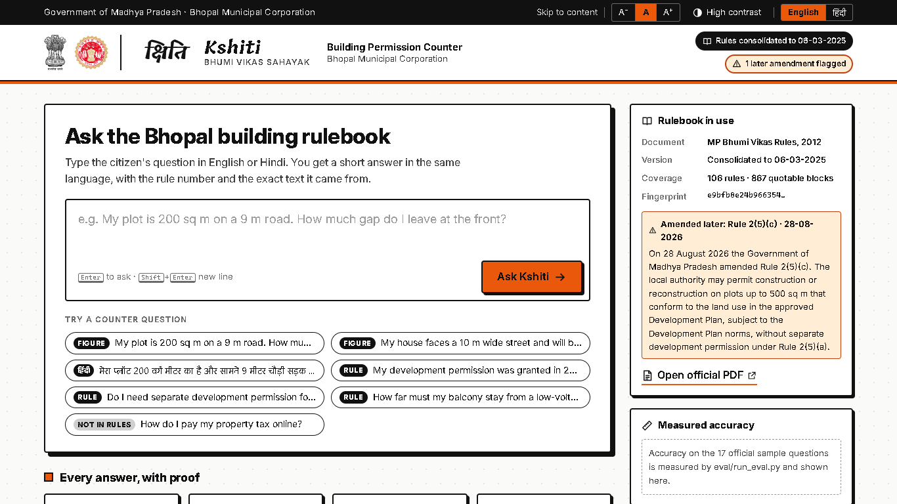
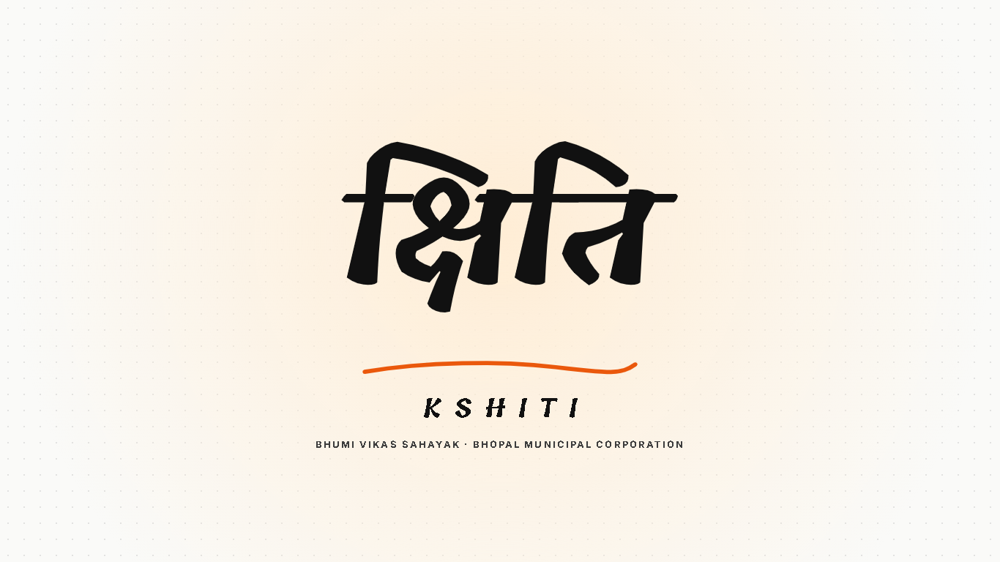
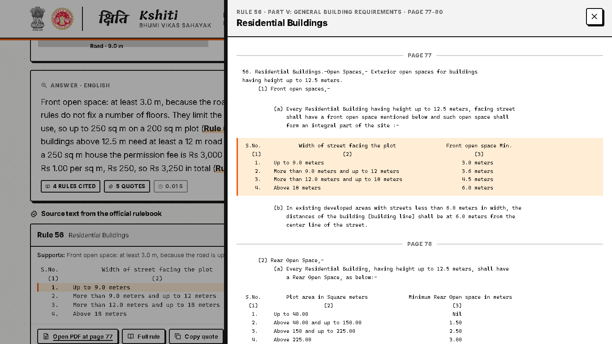
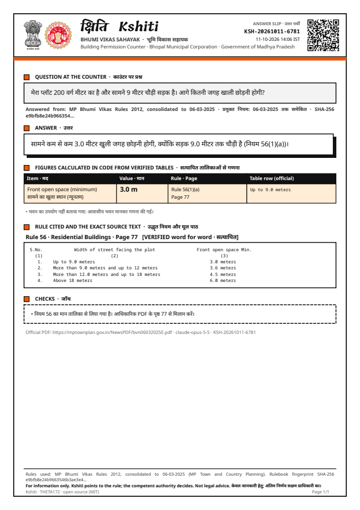
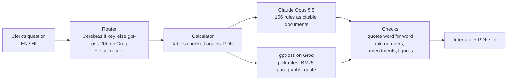

# Kshiti · क्षिति — Bhumi Vikas Sahayak

**Ask the Bhopal building rulebook. Get a short answer in your language, with the rule number and the exact text it came from. When the rules are silent, Kshiti says so.**

| | |
|---|---|
| **Track** | Track 1 · Bhumi Vikas Sahayak · Claude Impact Lab × Cerebras, Bhopal, 11 October 2026 |
| **Team** | THETA172 |
| **Members** | Priyanshu Sharma (solo) |
| **The one user** | A building-permission clerk at the Bhopal Municipal Corporation counter |
| **Live demo** | **https://kshiti-two.vercel.app** (Claude Opus 5.5 answers; limited to 30 questions per visitor per 10 minutes) |
| **The one workflow** | A citizen asks → the clerk types the question in English or Hindi → a cited answer in under a minute → a printable PDF slip for the citizen |

## The problem

The MP Bhumi Vikas Rules, 2012 run to 108 pages and 105 rules. The numbers people ask about most (setbacks, floor area, fees) sit in tables in different parts of the book, the rules keep changing, and questions come in English and Hindi. A clerk needs a correct answer within a minute, with the rule number to show the citizen.

## What Kshiti does

1. **Reads the question** in about a second: language, topic, likely rules and the citizen's numbers, such as road width or plot area. Cerebras is used when a Cerebras key is set; otherwise the same router runs on free inference (gpt-oss-20b on Groq); a local rule-based reader fills gaps and takes over if both are unavailable.
2. **Calculates figures in code** from tables checked against the official PDF: front, rear and side open space, FAR and maximum built-up area, height band, and fees.
3. **Writes a short cited answer** from the rules only, in the question's language, citing the exact paragraph or table. Two engines, same checks:
   - **Claude Opus 5.5** (main engine, used when `ANTHROPIC_API_KEY` is set): all 106 rules as citable documents with built-in citations and prompt caching.
   - **gpt-oss-120b on Groq** (free fallback, used when only `GROQ_API_KEY` is set): gpt-oss-20b picks the likely rules from the 106 titles, a BM25 search picks the best paragraphs, and gpt-oss-120b answers quoting them exactly.
4. **Checks every quote word for word** against the official text. A quote that does not match is removed. Rule numbers that do not exist are flagged.
5. **Shows the proof:** rule, sub-rule, PDF page, the official text with the matching table row highlighted, and a link that opens the PDF at that page.
6. **Prints a PDF answer slip** for the citizen, with a receipt ID, QR code and the version of the rules used.

## Why it can be trusted (what makes it different)

| Promise | How it is enforced |
|---|---|
| **Every answer shows its rule and source text** | The rulebook is split into 867 quotable blocks with their PDF page. Every quote either engine gives is matched word for word against the data pack (`kshiti/verify.py`). |
| **No invented rules** | Unknown rule numbers in an answer are flagged. An answer with no verified quote is marked "Not verified" and never shown as confident. |
| **Table numbers are right** | Figures come from `data/tables/tables.json`, read from the official PDF (pages 35, 36, 58, 77, 78, 83). Tests check every row and boundary against the rule text (`tests/test_calculator.py`). The language model is given the same figures, a cross-check warns if its wording differs, and the official table is always attached as a citation. If the model fails or wrongly says "not found" while the calculator has a verified figure, the figure wins and the answer says it was written from the calculator. |
| **Says "not found"** | A dedicated "not found" outcome for questions the rules do not cover (property tax, land prices). Kshiti never answers those from general knowledge. |
| **Never assumes the citizen's facts** | If road width, plot area or height is missing, Kshiti asks for it with a short form. Assumptions it does make (for example "residential use") are shown on screen. |
| **Knows which version of the rules it used** | Every answer and slip shows "consolidated to 06-03-2025" and a SHA-256 fingerprint of the rulebook. The 28-08-2026 amendment to Rule 2(5)(c) is flagged where it applies. |
| **Fast enough for a queue** | Figures appear in milliseconds; the cited answer follows within seconds (median 12.8 s with Claude Opus 5.5 on the sample questions), well inside the one-minute target. |

## Accuracy on the 17 official sample questions

The answer key is in [eval/answer_key.json](eval/answer_key.json), with the expected rule and figures for each question.

Both engines were run on all 17 questions on 11-10-2026 (`python eval/run_eval.py`). Per-question details: [eval/results.md](eval/results.md) (Claude) and [eval/results_groq.md](eval/results_groq.md) (Groq).

| Measure | **Claude Opus 5.5** (main) | gpt-oss-120b on Groq (free fallback) |
|---|---|---|
| Correct rule cited (15 questions the rules answer) | **15/15** | 15/15 |
| "Not found" when the rules are silent (Q16 property tax, Q17 land price) | **2/2** | 2/2 |
| Wrong "not found" on answerable questions | **0** | 0 * |
| Correct table figures (Q1 3.6 m, Q2 0.40 ha and FAR 0.10, Q5 2.5 m and 1.2 m, Q10 1.5 m, Q14 3.0 m) | **5/5** | 5/5 |
| Answer in the question's language | **17/17** | 17/17 |
| Quotes verified word for word against the official text | **107/107** | 37/37 |
| Invented rule numbers | **0** | 0 |
| Later amendment flagged (Q11, Rule 2(5)(c), 28-08-2026) | **1/1** | 1/1 |
| Median time per answer | **12.8 s** | 29.6 s ** |

Read these results honestly:
- \* On Groq, Q14 (Hindi) was answered by the calculator: the model wrongly said "not found", and Kshiti's rule that a verified figure wins took over and labelled the answer. Claude answered Q14 itself.
- \*\* Groq's free tier allows 8,000 tokens per minute; the batch waited for the quota between questions. Single answers took 3 to 6 s.
- The groq run used the answer prompt before a last small instruction was added (name the calculator's rule for each figure); it was not re-run after that change.
- 17 questions is a small test. **The answer key** ([eval/answer_key.json](eval/answer_key.json)) was written by the team from the rule text; table figures were checked on the official PDF.

The interface shows these scores in its "Measured accuracy" panel. 85 unit tests cover the tables, quote checks, router, calculator, server and PDF (`pytest`).

## How to run it (5 steps)

1. `git clone https://github.com/Priyanshu12116/KSHITI.git && cd KSHITI`
2. `python -m venv .venv`, then activate it (`.venv\Scripts\activate` on Windows, `source .venv/bin/activate` elsewhere)
3. `pip install -r requirements.txt`
4. Copy `.env.example` to `.env` and add `ANTHROPIC_API_KEY` (Claude, main engine) and/or `GROQ_API_KEY` (free router, and fallback engine); `CEREBRAS_API_KEY` is optional
5. `python run.py`, then open http://localhost:8000

Optional: `pytest` runs the tests; `python eval/run_eval.py` measures accuracy.

**Deploy (Vercel):** `vercel link`, add `ANTHROPIC_API_KEY` and `GROQ_API_KEY` with `vercel env add`, then `vercel deploy --prod`. `vercel.json` and `api/index.py` are included; `KSHITI_RATE_LIMIT` sets questions per visitor per 10 minutes (default 30).

## What works and what does not

**Works**
- English, Hindi and Hindi typed in English letters ("aage kitni jagah chhodni hai"); answers follow the question's language.
- Cited answers for all 106 rules; calculated figures for residential front, rear and side open space (Rule 56), FAR and maximum built-up area (Rule 61), height band (Rule 42, Table 4) and building permission fees (Rule 21).
- Not found, missing-input form, amendment warning, table check warning, unverified answers, error and retry.
- PDF answer slip with receipt ID, QR code and rulebook fingerprint; full Hindi interface; high contrast and text size controls; works on a phone.

**Does not, or not yet**
- **Free Groq quota:** about 8,000 tokens per minute. One clerk asking questions is fine; several counters at once would need a paid key or the Claude engine.
- **Language models are not perfectly consistent:** on Groq the model once said "not found" for an answerable Hindi question (Q14); the calculator rule caught it. Questions without a calculator figure have no such backstop, only the quote check.
- **Cerebras:** the Cerebras router is built in but no Cerebras key was available; the same router ran on free inference (gpt-oss-20b on Groq).
- **Speed with Claude:** about 13 s per answer (the figures appear first, in milliseconds). A lower effort setting would be faster; accuracy was preferred.
- **Later amendments:** only the 28-08-2026 change to Rule 2(5)(c) is known, from a published summary; its exact Gazette text is not available, so it is flagged but never quoted.
- **Calculator scope:** residential setbacks, FAR, height band and fees only. Other uses (farm house, cinema, fuel station, industry) are answered from the cited text, never with residential figures.
- **Number of floors:** the rules limit height and built-up area but never state a number of floors. Kshiti says so.
- **Fee slabs** are whole square metres in the official table; a built-up area between slabs (for example 75.5 sq m) is put in the next slab.
- **Hindi source text:** quotes are from the English PDF (the source of truth). The official Hindi PDF uses an old font that cannot be machine-read.
- **Development Plan:** a town's Development Plan may set different norms (Rule 103). Kshiti cannot see Development Plans.
- **Not legal advice.** Kshiti points to the rule; the competent authority decides.

## Screenshots

| Opening | Rule drawer | PDF slip (Hindi) |
|---|---|---|
|  |  |  |

[Answer screen](docs/screenshots/03_answer_live.png) (live answer from Claude Opus 5.5).

## How it is built

| Part | Where |
|---|---|
| Rulebook loading, quotable blocks with PDF pages | `kshiti/rules.py` |
| Claude answer engine (citations, tools, caching, streaming) | `kshiti/engine.py`, `kshiti/prompts.py` |
| Groq answer engine (rule picking, BM25 paragraphs, exact quotes) | `kshiti/groq_engine.py` |
| Quote check, invented-rule check, warnings | `kshiti/verify.py` |
| Calculator and checked tables | `kshiti/calculator.py`, `data/tables/tables.json` |
| Cerebras router with rule-based fallback | `kshiti/router.py` |
| Pipeline | `kshiti/pipeline.py` |
| PDF slip template | `kshiti/slip.py` |
| Web server and interface (no build step) | `app/server.py`, `app/static/` |
| Evaluation | `eval/run_eval.py`, `eval/answer_key.json` |

Safety of the AI parts: the reader (and Cerebras, when used) only classifies the question and extracts numbers; any number not written in the question is discarded. The language model only writes the answer text; figures come from code, and quotes are checked against the official text before they are shown.

## Data used

| Data | Source |
|---|---|
| MP Bhumi Vikas Rules 2012, consolidated to 06-03-2025: rules JSONL, page text, English and Hindi PDFs, 17 sample questions | Official Track 1 data pack: https://github.com/Vishal4742/bhopal-impact-lab-2026-problem-statements (English PDF: https://mptownplan.gov.in/NewsPDF/bvn06032025E.pdf) |
| Amendment of 28-08-2026 to Rule 2(5)(c), plots up to 500 sq m (summary) | https://teamleaseregtech.com/updates/article/59469/government-of-madhya-pradesh-amendment-to-land-development-rules, linked in the official problem statement |
| Emblem of India; Emblem of Madhya Pradesh | Wikimedia Commons (public domain). Used with permission obtained by the team. No government portal was scraped. |
| Fonts: Tillana, Anek Devanagari, Inter, Noto Sans, Noto Sans Devanagari, Noto Sans Mono | Google Fonts / Noto, SIL Open Font License |

No personal data is used or stored. Issued slips are logged locally (question, rules cited, time) in `logs/`, which is not committed.

## Security

API keys are read from `.env` (not committed; see `.env.example`). No keys or secrets are in the code.

## License

MIT, see [LICENSE](LICENSE). Offered to the Government of Madhya Pradesh through MPSeDC.

Built by **Priyanshu Sharma · THETA172**.
